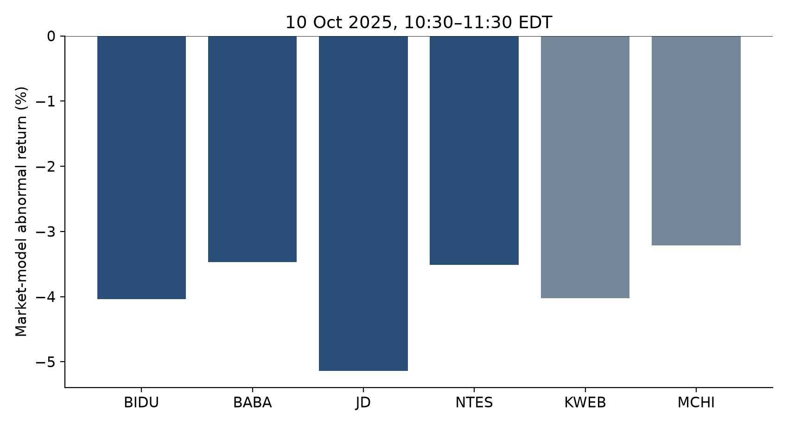
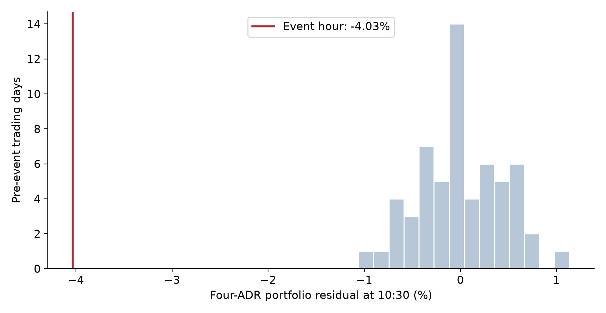
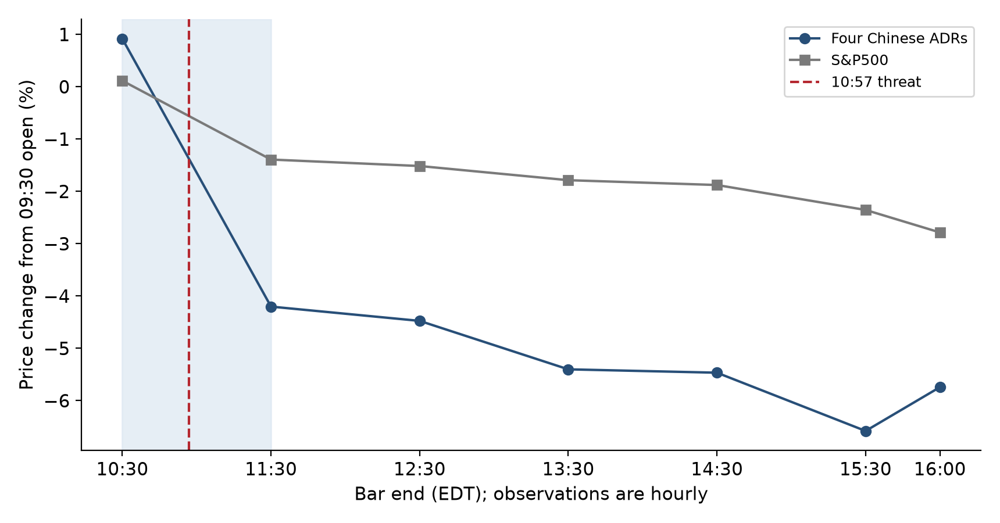
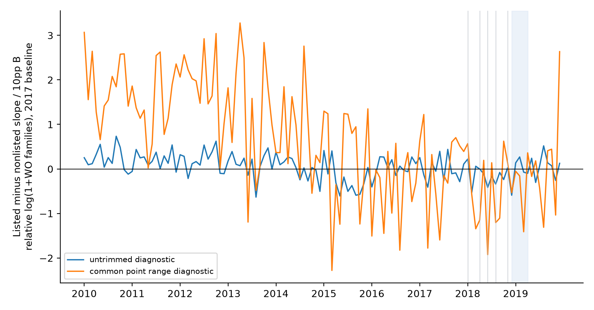

# 미국의 규제 예고와 중국의 기술 대응
## 2018년 기술통제 신호와 2025년 관세 위협의 실증분석

박찬진 | 2026년 11월 14일 | 연구논문 작업본

### 초록

미국의 규제는 실제 거래를 제한하기 전에 중국 기업의 기대와 연구 배분에 영향을 주는가? 본 연구는 발표의 정보 효과와 후속 연구 배분 효과를 구분하여 분석한다. 2018년 신흥 기술 수출 통제 예고에 대해서는 2017년 기술 분류와 과거 공개 특허를 연결하여 미국 기술 의존도를 구성하고, 지목· 비지목 기술의 중국과 비교 국 특허 경로를 추정한다. 새로운 표본은 18개 기술 단위, 5개국, 2010 –2019년 120개월의 10,800 셀이다. 사전 공개 공보의 출원인 국가를 적용하고, 미국 인용 비중과 세계 다 관청 특허에서 미국 출원인 국가 비중을 별도로 계산한다. 지목· 비지목 기술의 의존도 공통 지지와 사전 경로는 충분하지 않아 이 결과를 연구 배분의 인과 효과로 채택하지 않는다.

발표 자체의 정보 내용을 더 직접적으로 관측하기 위해 2025년 10월 10일 미국의 대중 보복 예고를 시간별 자료로 추가 분석한다. 10:57 EDT의 선행 관세 위협을 포함하는 10:30–11:30에 중국 ADR 4 기업의 동일 가중 포트폴리오는 −5.09 %, S&P500 시장 모형 조정 후 −4.03 % 움직였다. 같은 시간의 중국 인터넷 ETF KWEB와 중국 주식 ETF MCHI의 초과 수익률은 각각 −4.02 %, −3.21 %다. 구체적인 추가 100 % 관세와 핵심 소프트웨어 수출 통제 예고는 그날16:50 EDT의 장 후 발언이므로, 정규 장 하락을 그 구체적 소프트웨어 예고의 효과로 명명할 수 없다. 오래된 사전 특허 의존도와 시간별 가격 반응의 기울기는 기업 하나 제외에 따라 부호가 바뀐다. 이 결과는 규제 예고의 정보 내용과 중국 전반의 위험 재평가를 보여 주지만, 자립 연구 개발 증가의 직접 증거는 아니다. 간단한 투자 모형은 동일한 음의 시장 가치 반응 아래에서도 연구 투자가 증가하거나 감소할 수 있음을 보인다. 본 연구의 핵심은 처음 정보가 도착한 시각, 추가 법적 제한의 적용, 기술 의존도, 실제 연구 결정의 시계를 연결하는 데 있다.

주제어: 수출 통제, 발표 효과, 정책 불확실성, 기술 의존도, 중국 혁신, 사건 연구

## 1. 서론

기술 안보 정책은 목록 등재와 허가 거부로만 작동하지 않는다. 앞으로 접근을 차단할 수 있다는 신호가 충분히 신뢰할 만하다면 기업은 규칙의 실제 적용 전에 현금 흐름, 공급망과 연구 계획을 다시 평가한다. 발표 이전과 이후의 반응을 실제 제한의 효과와 합치면, 통제 때문에 발생한 접근 손실과 통제 가능성 때문에 발생한 기대 변화를 구분하기 어렵다. 이 구분은 정책 평가에 중요하다. 규제가 최종 시행되지 않았더라도 그 위협이 정보 효과를 가질 수 있으며, 같은 가격 하락이 기술 자립 투자의 확대와 위축 양 쪽에 부합할 수 있기 때문이다.

본 연구의 출발 질문은 미국의 첨단 기술 수출 통제 신호가 중국의 선제적 연구· 자본 배분을 바꾸었는가이다. 이 질문은 세 개의 경험적 명제를 포함한다. 첫째, 신호가 새로운 정보를 전달했는가. 둘째, 미국 기술에 더 의존하는 기업이나 기술이 더 크게 반응했는가. 셋째, 그 반응이 실제 연구· 투자 선택으로 연결되었는가. 한 명제의 관측을 다른 명제의 증명으로 사용하지 않는 것이 본 연구의 식별 원칙이다.

2018년 사례에서는 DIUx 보고서, ZTE 조치, 의회 논의, ECRA, ANPRM이 연속적으로 도착했다. 따라서 ANPRM 하루를 최초 충격으로 간주하지 않고 동적 노출 경로를 살펴본다. 그러나 기술별 미국 의존도를 달리하는 중국 정책, 추격 성장과 실제 제한이 동시에 존재한다. 이 문제에 대응하기 위해 같은 분류 절차로 비지목 기술을 구성하고, 비교 국의 기술별 변화와 함께 추정한다. 이론과 관측을 대조한 결과, 현재 특허 자료에서 대조 군 지원과 사전 경로가 약하다는 사실이 수치로 확인된다.

그 때문에 발표의 정보 내용에 대한 별도 검증으로 2025년 자료를 추가한다. 트럼프 2기의 위협 중에는 미래 시행일을 제시한 뒤 협상에서 철회되거나 유예된 조치가 있다. 2025년 10월 10일의 대중 보복 위협은 같은 날의 장중 선행 발언과 장 후 구체적 예고를 구분할 수 있어 유용하다. 자료가 허용하는 한 시간의 사건 창에서 중국 ADR 및 중국 ETF의 반응을 측정하고, 일별 창에 들어오는 후속 완화 발언과 구분한다. 이 추가 분석은 원래의 연구 배분 질문을 대체하는 인과 추정이 아니라, 그 질문에 필요한 첫 번째 명제인 발표의 정보 내용을 검증한다.

본 논문은 원문에서 처치와 날짜를 확인한 선행 연구에 기대어 연구한다. 관세 발표가 주식 가격과 후속 실물 성과에 연결된다는 연구는 이미 존재한다. 본 연구의 기여는 기술 안보 신호의 시각과 시행 시계를 연결하고, 공개 특허 의존도 지표가 실제로 지지하는 비교 범위를 계량적으로 확인하며, 시장 가치의 변화와 연구 배분의 방향을 분리하여 검증하는 데 있다. 분석은 탐색적이며, 단일 에피소드와 목적 표본에서 전체 중국 기업의 평균 효과를 식별했다는 주장은 하지 않는다.

## 2. 제도적 배경과 사건 시계

### 2.1. 2018년 신호의 연쇄

ANPRM은 광범위한 신흥 기술 범주를 열거하고 의견을 요청하는 절차다. 지목되었다는 사실만으로 해당 범주의 모든 품목이 새롭게 중국에 수출 금지되었다고 코딩할 수 없다. ECRA §1758의 해외 기술 발전과 통제 효과성 고려는 잠재적 기술 손실을 조사할 제도적 동기를 제공하지만, 특허의 미국 인용 비중이 그 손실의 충분 통계 량임을 보장하지 않는다.

| 신호 | 확인된 시점 | 분석에서의 역할 |
|---|---|---|
| DIUx 기술이전 보고서 | 2018년 1월, 일자 미확인 | 월별 경로; 일간 사건 연구 제외 |
| ZTE 조치 | 2018년 4월의 실제 제한;7월 해제 | 신뢰성 신호와 직접 접근 제한이 함께 존재 |
| 하원 논의 | 2018년 6월 26일 | 입법상 신호; 최초 인지 시각은 별도 문제 |
| ECRA 제정 | 2018년 8월 13일 | 제도 형성; 법 제정 일과 품목 통제 일 구 분 |
| ANPRM 공개 열람 | 2018년 11월 16일08:45 EST | ADR 정규 장 전; 중국· 홍콩21:45 |
| ANPRM 관보 게재 | 2018년 11월 19일 | 같은 공고의 게재; 독립된 두 번째 충격 아님 |

ZTE denial order, 2018년 7 –9월 Section301 관세, 2018년 10월 Jinhua, 2019년 5월 Huawei 및 이후 FDPR은 ANPRM 목록과 별개로 노출될 수 있다. 특히 2018년 10월 24일 고성능 컴퓨터의 APP 기준 개정은 일부 문턱의 완화였다. GPU의 상품명이나 FP16/FP32 수치를 APP와 동일시하여 제한 여부를 정하지 않는다. 검토 근거는 83FR53742,83FR58201 및 각 당시 EAR 규칙이다.

후보 연구 결정 창은 2018년 12월 –2019년 4월이다. 이는 Huawei의 2019년 5월 16일 추가 지정 전의 완전 월이지만, 다른 모든 제한이 없었던 기간은 아니다. NSFC의 2019년 집중 신청 마감은 3월 20일16:00으로 이 창에 들어간다. 그러나 현재 확보된 자료는 주로 승인 과제 목록이며 전체 신청· 정확한 신청 일 자료가 아니다. 승인 과정이 이후 정책에 반응할 수 있으므로 이를 신청 단계의 선제적 선택과 동일시하지 않는다.

### 2.2. 2025년 발표·완화·준수의 구분

10월10일의 대통령 게시물 기록은 시각을 Pacific time으로 명시한다. 07:57 PDT는10:57 EDT다. 이 발언은 대중 보복과 관세 대폭인상을 검토한다고 밝혔다. 같은날13:50 PDT, 즉16:50 EDT의 게시물이11월1일 추가100% 관세와 핵심 소프트웨어 수출통제를 구체적으로 예고했다. 정규장은16:00에 끝나므로 두 시각의 순서는 실증설계에 직접 중요하다. [대통령 원 게시물 연결을 포함한 APP 기록](https://www.presidency.ucsb.edu/documents/truth-social-posts-october-10-2025).

10월12일의 완화성 발언은 월요일 미국·아시아 개장 전이었다. 따라서10월13일의 일별 반응에는 강화 예고와 완화 발언이 함께 들어간다. 추가100% 관세 위협의 협상상 철회는10월26일 재무장관의 공개 인터뷰에서 확인된다. 이 발언을 소프트웨어 통제의 최종 규칙·철회 상태까지 확인한 것으로 확대하지 않는다. [10월12일 대통령 기록](https://www.presidency.ucsb.edu/documents/truth-social-posts-october-12-2025), [10월26일 재무장관 인터뷰](https://www.cbsnews.com/amp/news/scott-bessent-treasury-secretary-face-the-nation-transcript-10-26-2025/).

| 미국 동부 시각 | 정보 도착 | 사용 가능한 가격 관측 |
|---|---|---|
| 10월 10일10:57 | 선행 대중 보복· 관세 위협 | 정규 장10:30–11:30 bar |
| 10월 10일16:50 | 추가 100 % 관세·software 예고 | 시간 외 OHLC 있으나 거래량 0 보고; 주 추정 제외 |
| 10월 12일12:43 | 대통령 완화성 발언 | 다음 미국 거래일 10월 13일에 함께 반영 |
| 10월 26일 일요일 | 추가 100 % 위협이 협상에서 배제되었다는 발언 | 후속 완화 사건; 주창과 독립적인 동일시 금지 |
| 11월 1일 | 10월 10일 게시물의 예정 시행 일 | 10월 10일 주창보다 뒤; 기존 제한과 구분 |

AI Diffusion 사례는 추가 제도 비교다. 규칙의 법적 효력일은2025년1월13일, 주요 준수일은5월15일이었다. BIS의5월13일 불집행 발표와 정식 철회 절차도 다르다. GAO는2026년5월 결정에서 이를 구분했다. 그러므로 이 사례를 단순히 '법적 효력이 전혀 없었던 트럼프 신설 통제'로 코딩하지 않는다. [GAO B-337935](https://www.gao.gov/products/b-337935).

## 3. 선행연구와 본 연구의 추정 대상

Kang, Ma, Xie and Zhong(2025)은 중국 기업의 혁신에 관한 ANPRM 노출을 연구한다. 원문의 Post는 2018년보다 뒤인 2019 –2022년이며,2013 –2017년 주제 관련 특허 비중과 사전 특허 수를 활용한다. 본 연구가 구성하는 사전 미국 의존도 B와 동일한 처치가 아니고, 그 Post 전체가 실제 추가 제한 이전의 발표 구간은 아니다. Shen et al.(2024)은 직접· 계열· 공급망· 텍스트 노출을 분석한다. 관련 기술 수입 지표를 미국만의 의존도로 치환하지 않는다. 이들 연구는 중요한 비교 대상이지만, 본 연구의 단계별 발표 시계를 대신하지 않는다.

| 연구 | 핵심 식별 구조 | 본 연구에 주는 기준 |
|---|---|---|
| Pierce & Schott(2016) | PNTR 이후 × 사전 NTR gap | 실제 제도 변화와 사전 손실 강도 구분 |
| Handley & Limão(2017) | 정책 불확실성 축소와 진입· 수출 | 미래 손실의 기대가 현재 선택에 영향 |
| Blume-Kohout & Sood(2013) | Medicare 시장 노출과 시점별 R &D | 노출· 시행· 중간 실제 혜택의 시계 확인 |
| Moser & Voena(2012) | 강제실시권 이후 기술별 비교 | 기술 지식 접근의 실제 변화와 선택 문제 |
| Malani & Reif(2015) | 개혁의 기대 형성과 사전 반응 | 최초 신호 이후를 anticipation으로 해석 가능 |
| Callaway et al.(2024) | 연속 처치 DiD의 식별과 집계 | dose 선택과 TWFE 기울기를 인과 함수와 구분 |
| Amiti et al.(2026 개정) | 관세 발표· 자산 가격· 후속 성과 | 가격 반응과 실물성과 연결에 추가 구조 필요 |
| Acharya & Laarits(2026) | 2025 관세 충격· 장중 가격 | 짧은 창, 다른 금융 경로와 표본의 구분 |

Amiti, Gomez, Kong and Weinstein의2026년5월 개정본은2025–2026년 사건도 포함한다. 저자 소속기관은 Journal of Finance 게재예정을 표시한다. 따라서2025 자료를 사용하거나 관세 발표의 주가효과를 보인다는 것만으로 최초성을 주장할 수 없다. 본 연구는 중국 기술의존도와 혁신배분에 관한 추가 명제를 따로 검증한다. [NBER WP28758](https://www.nber.org/papers/w28758), [저자 공식 출판목록](https://www.newyorkfed.org/research/economists/amiti/pub).

## 4. 이론: 기대 손실과 연구투자의 방향

기업이 자체 연구 투자 I와 외부 기술 접근 a를 이용해 수익을 얻는다고 하자. 규제 확률은 p, 완전한 통제 때의 접근 손실은 D>0이다.

$$ a(p)=a_0-pD,\qquad V(p)=\max_I\{R(I,a(p))-C(I)\}. \tag{1} $$

내부해에서 C''−R_II>0이고 외부 기술 접근의 한계 수익 R_a>0이면,

$$ \frac{dI^*}{dp}=-\frac{D R_{Ia}}{C''-R_{II}},\qquad \frac{dV}{dp}=-D R_a<0. \tag{2} $$

연구 투자와 미국 기술이 대체재라면 R_Ia<0으로 규제 가능성 상승이 자체 연구를 늘린다. 보완재라면 R_Ia>0으로 자체 연구도 감소할 수 있다. 두 경우 모두 시장 가치는 하락할 수 있다. 따라서 음의 발표 일 주가 반응은 정보 효과에 부합하지만 연구 투자 증가의 충분조건은 아니다. 이 단순 모형은 새 정리의 최초성 주장보다 경험적 추론의 범위를 명확히 하는 역할을 한다.

가설 H1은 실제 추가 제한 전 신호가 시장 가치를 변화시킨다는 것이다. H2는 미국 기술 의존도가 높은 기업· 기술의 반응이 더 크다는 것이다. H3은 자체 연구· 투자 배분이 변한다는 것이다. H3의 방향은 대체와 보완 관계에 달려 있다. 본 연구는 H1 –H3을 같은 가설로 합치지 않는다.

## 5. 데이터와 측정

### 5.1. 기술분류와 특허 패널

2017년 IPC의 공식 기술 의미와 2018년 ANPRM 문구를 연결했다. 지목 후보 12 행은 신경· 유전 계산, 지식 기반 계산, 영상 분석, 음성 합성· 인식과 적층 제조를 포함한다. 비지목 후보 12 행은 통상적인 성형· 절 삭· 연 삭이다.2018 –2026년 공식 개정 표를 연결한 exact membership는 348개다. 초기 309개 코드와 개정 경로는 별도 파서로 재현되었다.

B33Y는 보충· 다중 분류이며 first IPC로 놓이지 않는 특성이 있다. 따라서 여섯 aspect를 여섯 독립 기술로 세지 않고 family 합 집합으로 묶었다. 신경· 유전 계산도 합쳐 분석 단위는 지목 6, 비지목 12가 된다. subgroup와 main-group의 계층이 완전히 동일한 표본은 아니며, 비지목은 법률상 미통제나 다른 중국 정책의 무노출을 뜻하지 않는다. 미래의 분류 정비가 과거 문헌에 반영될 수 있으므로 2017년 당시 분류 정보를 완전히 복원했다고 주장하지 않는다.

WO 출원의 earliest filing month가 2010 –2019년이고 그 출원의 최초 공개가 filing 후 24개월 이내인 자료를 집계한다. 국가귀속은 현재 출원별 명의가 아니라 해당 출원의 최초 공보에 연결된 출원인 주소 국가를 쓴다. 한 family가 여러 국가· 기술에 속할 수 있으므로 합계 32,330은 세계 고유 발명 수가 아니다. 국가· 기술· 월별 family 소속의 합이다.0을 포함한 10,800 셀 중 4,085 셀이 양수다. EPO TIP의 실제 실행쿼리와 압축 원 자료를 보존했으며, 서비스 dataset 명만으로 특정 PATSTAT 배포 판을 확정하지 않는다.

### 5.2. 미국기술 의존도

첫 지표 B^cit_k는 2013 –2017년 공개된 WO source 문헌과 중국 주소 출원인에 연결된 family에서, 과거 공개 문헌으로의 backward citation을 집계한다. source –target DOCDB family 쌍을 중복 제거하고 자기 family 인용을 제외한다. ALL과 출원인 APP 태그가 있는 인용을 구분한다. 둘은 동일한 target 대표 공보를 사용한다.

둘째 지표 B^fam_k는 2013 –2017년에 처음 공개된 세계 DOCDB family 중,2017년까지 두 개 이상 national/regional 관청에 공개 출원이 관측되고 하나가 IP5인 부분집합을 쓴다. WO는 관청 수에서 제외했다. 해당 family 최초공보의 출원인 주소 국가 중 미국의 분 수 비중을 집계한다. 이는 중국의 미국 의존도와 다른 구성 개념이며, OECD 공식 IP5 통계를 그대로 복제한 지표도 아니다.

두 지표의 분수 분모는 알려진 상이한 주소 국가다. 일부 출원인의 국가만 알려진 경우와 인용 연결 실패는 별도 문제다. 완전히 국가가 미상인 쌍을0/1로 배분한 범위는 이 조건부 집계의 범위이며, 모든 측정 오차를 포괄하는 진실 값의 범위나 신뢰구간이 아니다. APP의 희소성은 특히 크다.18 단위 중 APP에서 알려진 국가를 가진 기술은 4개뿐이며 모두 매우 작은 표본이다.

### 5.3. 기업 및 시장자료

사전에 정한 목적 표본은 Baidu,Alibaba,JD,NetEase의 미국 ADR4 곳과 Tencent,Lenovo의 홍콩 2 곳, Dawning,Inspur,iFlytek,Hikvision의 A 주 4 곳이다. 중국 기업 전체를 대표하는 확률 표본은 아니다.2018년 분석은 2017 –2019년 14 가격 계열 10,361 행을,2025년 분석은 2023 –2025년 17 계열 12,583 행을 회수했다. 이후 정한 장중 추가 분석은 2025년 7 –10월 8 계열 8,877개의 시간별 관측을 확보했다. 시간별 분석은 일별 결과를 읽은 뒤 발언 시각을 기준으로 추가한 탐색이다.

가격은 Yahoo 공개 chart 원 자료의 현지 시장 시각, 조정 종가 또는 장중 OHLC, 거래량과 기업 행사를 보존했다. 일별 결측 가격을 전방 보 간하지 않았다. 같은 시장의 지수가 null이고 고정 비교 기업 모두 거래량 0 인 placeholder만 달력에서 제외한다. 시간 외 OHLC는 관측되지만 공급자가 거래 량을 0으로 보고하므로 주 모형에서 사용하지 않는다.

기업 B는 2017년 SEC 보고서에서 확인한 법인 부분 집합의 2013 –2017년 공개 문헌을 이용한다. 지분 자회사와 계약상 VIE를 구분했고 이름 prefix로 기업 집단을 통째로 합치지 않았다. 역사적 공보별 연결을 적용한 ALL source family는 Alibaba8,189/Baidu3,193/JD1,796/NetEase727이다. 이 수치는 2025년 현재 기업 집단 전체의 특허 수나 소유 구조를 의미하지 않는다.2025 결과에 붙인 기존 B는 오래된 사전 지표라는 한계를 가진다.

## 6. 계량경제학적 설계

### 6.1. 동적 기술노출 설계

국가 c, 기술 k, 월 t에 대해 다음을 출발점으로 둔다.

$$ Y_{ckt}=\alpha_{ck}+\delta_{ct}+\lambda_{kt}+\sum_\tau\beta_\tau\{CN_c(B_k/0.1)1[t=\tau]\}+\gamma CN_c CNPolicy_{kt}+\varepsilon_{ckt}. \tag{3} $$

단일 T =0을 주지 않고 최초 신호 이후의 경로를 본다. 첫 신호 이후의 변화는 anticipation일 수 있으나, 신호 전의 dose별 차이를 모두 anticipation이라고 부를 수는 없다. B는 정책의 실제 무작위 배정 강도가 아니라 사전 노출 지표다. 따라서 연속 처치 DiD의 식별 결과나 TWFE의 계수를 기계적으로 적용하지 않는다. dose 집단 사이 잠재 경로의 비교 가능성, 비선형 dose 반응과 서로 다른 노출의 교란을 검토해야한다.

비지목 기술 L_k =0을 추가하면 관심 계수는 다음의 차등 기울기다.

$$ \theta_\tau=\beta_{\tau,L=1}-\beta_{\tau,L=0}. \tag{4} $$

계산에서는 R_kt =log(1 +N_CN,kt)−평균 _d log(1 +N_d,kt)를 만들고 2017년 각 기술 평균을 뺀다. 지목· 비지목별 월 절편과 B/0.1의 별도 기울기를 적합한다. β는 B10 %p당 상대 log(1 +건수)의 변화이며 R &D 지출 증가율이 아니다. 국가 정보 20 쌍 이상이라는 추가 정밀 도 진단과 B의 공통 점 범위 표본도 보존한다. 이 기준을 사전 등록된 주 결과 cutoff로 소급하지 않는다.

특정 추가 제한 A_kt가 언제 적용되었는지 알 수 있다면 발표 구간과 적용 구간을 나눈다.

$$ \sum_\tau CN_c(B_k/0.1)1[t=\tau]\{\beta^A_\tau(1-A_{kt})+\beta^R_\tau A_{kt}\}. \tag{5} $$

2018년 모든 기술의 A_kt가 확인된 것은 아니다. 이를 0으로 채우지 않는다. 또한 β^A 는 강도별 차등 발표 반응이다. 발표의 수준 효과는 B =0에서 반응도 0이라는 외삽 등 추가 가정 없이 계산할 수 없다.

### 6.2. 일별·시간별 사건연구

일별 시장 모형은 각 시장의 벤치마크에 대해 거래 일[-250, −31], 최소 180개 완전 쌍으로 적합한다.

$$ R_{it}=a_i+b_iR_{mt}+u_{it},\quad CAR_i[\ell,h]=\sum_{t=\ell}^h(R_{it}-\hat a_i-\hat b_iR_{mt}). \tag{6} $$

2025년 10월 10일의 시간별 주창은 10:30–11:30 EDT로 고정했다. bar 수익률은 close/open−1이다. 실제 실행은 사건 직전 5거래일을 비운 뒤 그 앞 60거래일의 같은 10:30 bar를 후보로 삼았다. 최소 40개 완전쌍을 요구했고 실제 적합 표본은 59–60개다. 주벤치마크는 S&P500, 대체 기준은 SPY다. 네기업 포트폴리오 수익률을 먼저 평균내어 기업 간 공통오차를 보존한다. 최초 분석규칙의 ‘지난 60일 중 직전 5일 제외’라는 모호한 문구도 그대로 보존하고, 문자 그대로 해석한 55후보일 민감도를 추가했다. 이 경우 포트폴리오의 실제 완전쌍은 54개, AR은 −3.922%로 주값 −4.034%와 방향이 같다. 이는 결과 열람 후의 추가 민감도이며 사전에 고정한 별도 명세로 소급하지 않는다.

조건부 예측 표준 편차는 모형 오차의 동 분산· 시간 독립 가정 아래 s_p² =s²[1 +x'_e(X'X)^{-1}x_e]로 계산한다. 표준화 오차와 과거 같은 시각 잔차의 순위는 모형상 진단이다. 정책이 무작위 시각에 배정되었다는 p 값이나 장기 투자 효과의 신뢰구간이 아니다. 고빈도 식별은 해당 창에 다른 중국 특이 정보가 없고 시장 모형의 반 사실이 적절하다는 추가 가정에 의존한다.

## 7. 실증 결과

### 7.1. 실제 추가 제한 전의 가격 정보

표의 결과는10:57의 선행 위협을 포함한 한 시간의 관측이다. 모든 네 기업의 시장 조정 반응은 음수다. ETF는 별도의 금융 상품이며 그 안의 종목을 독립 표본으로 추가한 것이 아니다.

| 자산 | 원 수익률(%) | 시장 조정 AR(%) | 같은 시각적 합일 |
|---|---:|---:|---:|
| Baidu | −4.767 | −4.038 | 59 |
| Alibaba | −5.462 | −3.468 | 60 |
| JD | −6.107 | −5.139 | 59 |
| NetEase | −4.021 | −3.514 | 59 |
| 네 기업 동일 가중 | −5.089 | −4.034 | 59 |
| KWEB | −4.933 | −4.022 | 60 |
| MCHI | −3.964 | −3.215 | 59 |

자료:2025년 10월 10일10:30–11:30 EDT, Yahoo 시간별 OHLC와 S&P500, 저자 계산.

네 기업 포트폴리오의 조건부 예측 표준 편차는 0.663 %p, 표준화 예측 오차는 −6.09다. 과거 59개 같은 시각의 적합잔 차 중 절대 값이 사 건 창보다 큰 관측은 없었다. 이 사실은 큰 정보 갱신에 부합한다. 그러나 모형의 분포 가정과 단일 사건의 다른 정보를 배제하는 가정은 별도다. 두 종류의 산 식으로 재계산한 AR의 최대 차이는 8.9e-16%p였다.

시간별 경로에서 큰 정규 장 하락은 구체적인16:50 software 예고보다 먼저 발생한다. 이는 먼저 도착한 대중 보복 신호가 시장에 정보를 주었음을 시사한다. 그 후에 공개된 구체적 문구를 이미 끝난 정규 장 수익률의 원인으로 배정하면 시간 순서가 맞지 않는다. 한 시간 자료는10:57 전후의 분단 위 점프를 복원하지 않으므로 그 이상의 정밀도를 주장하지 않는다.

### 7.2. 전체 중국 위험과 기술특이 반응

벤치마크를 바꾸면 추정 대상도 바뀐다. S&P500에서 SPY로의 교체는 비슷한 미국 시장 비교이며 결과가 거의 같다. 반면 MCHI나 KWEB는 신호에 함께 반응하는 중국 자산이므로 이를 통제한 결과는 원래의 총 반응에 대한 교란 제거가 아니다.

| 네 기업 포트폴리오의 비교 기준 | AR(%) | 의미 |
|---|---:|---|
| S&P500 | −4.034 | 미국 시장 대비 반응 |
| SPY | −4.052 | 같은 미국 시장 기준의 민감 도 |
| MCHI | +2.018 | 중국 주식 가격 변화 조건부 상대 반응 |
| KWEB | +0.920 | 중국 인터넷 가격 변화 조건부 상대 반응 |

따라서 큰 음의 미국 시장 대비 반응을 곧바로 미국 기술 의존에 특유한 비용으로 해석하기 어렵다. 광범위한 중국 위험의 재평가가 동반되었다. 기존 특허 B와 네 기업 AR의 관측 기울기는 B10 %p당 +0.392 %p이며, 기업 하나를 제외하면 −1.117에서 +1.033 %p까지 변한다. 이 표본에서 의존도가 높을수록 더 음의 반응을 보였다는 H2를 확인하지 못했다. 오래된 B와 불완전한 기업 연결도 이 결론의 범위를 제한한다.

일별 창에서도 시계의 중요성이 확인된다. 같은 ADR4 곳의 10월 10일 일별 AR 평균은 −4.60 %,10월 13일은 +2.48 %다. 서로 다른 일자의 추정 구간과 새 정보가 들어가므로 이 수치를 단순히 강화와 철회의 인과 기여율로 분해하지 않는다.16:00–17:00의 시간 외 OHLC는 별도 표에 보존했지만, 거래량 0 보고를 실제 체결 량으로 간주하지 않았다.

### 7.3. 2018년 발표와 기업 의존도

ANPRM 공개 열람을 기준으로 미국 ADR의 거래일 0은 11월 16일, 홍콩·A 주는 11월 19일이다. ADR4 기업의 평균 CAR[-1, +1]은 +0.564 %,[0, +1]은 −2.555 %다. JD와 NetEase의 실적 반영일 중첩을 기계적으로 제외한 추가 표본에서는 각각 n =2, +0.170 %와 n =3, +0.142 %다. 원 표본을 결과 부호에 따라 교체하지 않는다. NVIDIA의 11월 15일 장 후 실적· 재고 뉴스와 APEC도 겹친다.

역사적 공보별 기업 B와 결합한 원 4 기업의 ANPRM 기울기는 B10 %p당 −1.553 %p([-1, +1])와 −0.274 %p([0, +1])다. 이 숫자는 실제 계산된 보강 자료지만 네 기업· 서로 다른 동시 뉴스· 미상 국가 때문에 순수 ANPRM 정보량으로 채택하지 않는다. 이미 읽은 특허 결과에 맞추어 신호 가중치를 사전 고정했다고 소급하지 않는다.

### 7.4. 지목·비지목 특허경로와 사전 추세

첫 B^cit에서 알려진 국가의 인용 20 쌍 이상을 가진 지 목 6 기술의 점 비중 범위는 0.303 –0.538, 비지목 4 기술은 0.018 –0.134다. 점 범위가 겹치지 않는다. 대체 B^fam에서는 일부 공통 점 범위 0.205 –0.294가 있지만, 그 안에는 지목 2/ 비지목 3 단위만 남는다. 이 점 범위는 측정 오차를 고려한 진정한 dose의 지지를 보장하지 않는다.

성숙 사전 2010 –2015년 매년 5 국 각각 family5개 이상이라는 지원 진단은 지목 영상 분석 P04만 통과했고 비지목은 0이었다. 새 최초공보 국가로도 같은 판정이다. 모든 0 셀을 포함하여 추정한 관측 대조는 다음과 같다.

| B 및 표본 | 지목/ 비지목 | 2018.12 –2019.4 θ | 2017 예측 RMSE |
|---|---:|---:|---:|
| 미국 인용, 비절단 진단 | 6/4 | −0.0396 | 0.6551 |
| 세계 다 관청 미국 비중, 비절단 | 6/11 | −0.0714 | 0.3470 |
| 다 관청 지표, 공통 점 범위 | 2/3 | −0.3586 | 0.9845 |

단위: B10 %p당 상대 log(1 +WO family) 기울기의 지목 −비지목 차이. 기준은 2017년. 인과 효과·R &D 증가율이 아니다.

공통 점 범위 표본의 2013 –2016년 12월 시작 가짜창 대조는 −1.133, −1.322, −1.101, −0.214로, 사전에도 큰 움직임을 보인다. 원 비중을 팔 안에서 재배정하는 4999회 기준 비교에서도 실제 대조의 절대 크기는 이례적이지 않았다. 정책 배정의 교환 가능성이 없으므로 이를 인과 randomization p 값으로 제시하지 않는다. 가짜 시점과 예측 보류 표본은 이번 자료에서 추격 수렴 문제가 제거되지 않았음을 보여 준다.

5개월 관측 대조의 사전 잔차를 사용한 조건부 MDE80 진단은 세 명 세에서 0.561,0.415,1.182다. 이는 특정 잔차· 시간 블록 모형에 대한 투영 통계 량의 검출 한계이며 실제 정책 효과의 식별 가능한 MDE가 아니다. 전 제가 실패한 명세에서 작은 표준 오차를 얻는 것만으로 발표 효과를 입증할 수 없다.

## 8. 해석과 식별 조건

2025년 결과에서 가장 분명한 관측은 실제 예정 적용 일보다 앞선 가격의 큰 정보 갱신이다. 다만 추정 대상은10:57의 대중 보복 위협 정보 묶음에 대한 반응이다. 구체적인 장 후 software 예고와 관세를 분리한 효과, 중국 기업 전체의 평균 효과, 자체 연구 증가를 한 계수로 주장하지 않는다. 가격에는 미래 현금 흐름과 위험 프리미엄이 함께 들어가며, 현재 표본만으로 둘을 분리할 수 없다.

고빈도 발표효과를 인과적으로 읽기 위해서는 같은 한 시간에 다른 중국특이 정보가 없고, 사건이 미리 완전히 예상되지 않았으며, 비교 시장모형의 반사실이 적절해야 한다. 중국의Qualcomm 조사 공지는10월10일17:00 중국 현지 표기(EDT05:00에 대응)로 주창보다 먼저다. 이것이 모든 동시뉴스의 부재를 증명하지는 않는다. 일별보다 짧은 창은 정보의 혼합을 줄이지만 완전히 제거하지 않는다. [중국 시장감독총국 공지](https://www.samr.gov.cn/xw/zj/art/2025/art_d1fc65d76fd8491a8f5ab7405c5ed798.html).

2018년 기술 패널에는 더 강한 조건이 필요하다. 중국의 선행 정책과 기술별 추격 속도가 B와 관련되어 있으면 α_ck, δ_ct, λ_kt만으로 제거되지 않는다. CNPolicy를 넣더라도 정책과 B의 독립 변동 및 측정이 있어야한다. 중국 2018년 35개 병목 기술 연재를 신호 이후 경로로 볼지 교란으로 볼지도 날짜와 정책의 선행 여부에 따라 정해야한다. 이미 존재하던 정책을 신호의 매개로 간주하여 통제에서 빼거나, 신호가 유발한 새 대응을 원인 이전 교란으로 통제하는 선택은 피한다.

비지목 기술은 같은 미국 의존도에서 중국의 독자 수렴을 관측하기 위한 비교 장치였다. 실제 집계에서는 지원과 공통 지지가 부족했다. 현재 결과는 그 설계가 원래의 인과 질문에 충분한 비교를 제공하지 못함을 뜻하며, 규제 예고의 실제 효과가 0이라는 증거는 아니다. 사용 가능한 자유로운 중국 × 기술 × 시점 교란을 허용하면 동일한 관측 경로에 서로 다른 인과 효과가 부합한다. 민감 도 분석도 그 교란의 크기에 외부 근거를 주어야한다.

## 9. 결론

미국의 규제 위협은 구체적인 시행 이전에도 가격에 빠르게 반영될 수 있다.2025년 10월 10일 선행 위협을 포함한 한 시간의 중국 ADR 및 ETF 반응은 그 정보 내용을 보여 준다. 동시에 정규 장 하락과 장 후 소프트웨어 예고를 같은 시각의 사건으로 취급하면 잘못된 원인 배정이 발생한다. 신호의 연쇄를 고려한다는 원래 설계의 필요성이 실제 장중 자료에서도 확인된다.

미국 기술 의존도에 특유한 차등 반응과 연구 배분의 변화는 별도의 명제다. 현재 네 기업 지표의 기울기는 안정적이지 않고,2018년 지목· 비지목 특허 패널은 충분한 사전 지지와 비교 경로를 제공하지 않는다. 따라서 본 연구는 발표의 가격 정보 효과에 대한 관측 증거와 연구 배분에 대한 증거의 범위를 구분한다. 추가 실증의 핵심은 2024년 기업별 실제 software· 장비 의존도와 미국 매출 노출을 분리하고, 신청· 연구 결정· 조달 선택이 확정된 시점의 자료를 연결하는 것이다. 이 자료와 비교 가능성이 확보될 때 발표가 기술 자립을 촉진했는지 또는 연구 자체를 위축시켰는지를 식(2)의 두 경로 사이에서 판정할 수 있다.

## 부록 A. 재현과 분석 상태

주요 결과 표와 그림은 실제 원자료에서 계산했다. 신규 최초 공보 국가 패널은 18×5×120, 양수 4,085 셀, 소속 합 32,330이다. 분석 자료의 0은 관측되는 해당 필터의 family가 0이라는 뜻이며 중국의 연구 전체가 없었다는 뜻은 아니다. ALL/APP에서 인용이 없거나 알려진 국가가 없으면 B를 0으로 만들지 않는다.

시간별 자료는 8개 금융 계열 8,877bar를 회수했고, 주 창 4 기업 포트폴리오의 산 식별 재계산이 일치했다. 시간 외 거래량 0 보고 자료는 quote-only 표로 따로 두었다. 같은 China ETF를 비교 기준으로 바꾸는 것은 추정 대상의 변경이다. 발표에 영향을 받는 변수를 무해한 통제로 보지 않는다.

공식 WIPO 분류 연결표와 2018년 시장자료는 작성자와 다른 검증자가 원문과 숫자를 재확인했다. 별도로 작성한 PATSTAT 쿼리로 2기술의 60지원행과 기업·기술 20의존도행을 재조회했다. 서비스에서 지원하지 않은 IN 구문을 동일한 distinct-key JOIN으로 바꾼 실행 수정과 원쿼리를 모두 보존했다. 비교한 100수치의 최대차이는 5.46e-12였다. 최초공보 국가 패널과 2025년 시간별 분석은 저자의 추가 집계이며, 별도 산식검산을 수행했다. 새 결과 전체의 독립 재현과 외부 심사가 완료되었다고 주장하지 않는다.

분석정의, 결과를 열람한 순서, 부적합했던 비교와 결측 처리를 재현자료에 보존했다. 이 논문은 사전등록된 확증연구가 아닌 탐색적 연구논문 작업본이다.

## 부록 B. 주요 반론과 판정

| 반론 | 현재 답변과 추가로 필요한 증거 |
|---|---|
| 2025 주가 변화는 실제 시행 때문인가 | 주창은 추가 예고의 예정 시행일보다 앞선다. 기존 제한이 없었다는 주장은 하지 않는다. |
| 장중 하락은 software 통제 효과인가 | 구체적 software 예고는 장 후16:50이므로 주창 효과의 명칭으로 쓰지 않는다. |
| 중국 전체 위험과 기술 특이 비용을 구분했는가 | China ETF 상대 반응은 양수로 바뀐다.affectedbenchmark를 쓴 변경된 대조이며 분리된 인과 효과는 아니다. |
| B는 실제 접근 차단 손실인가 | 특허 주 소 국가의 proxy다. 공개 지식과 거래 통제의 차이, 국가 미상과 기업 경계를 보존한다. |
| 중국의 추격 수렴인가 | 비지목 placebo와 2017 보류예 측에서 제거되지 않았다. 원특허 설계의 인과 계수를 채택하지 않는다. |
| CAR 하락이면 연구 자립이 증가했는가 | 식(2)에서 대체· 보완 관계에 따라 투자 방향이 다르다. 신청· 투자 결정 자료가 필요하다. |
| 2025 사례를 넣으면 최초성이 확보되는가 | Amiti 등의 최신 원문이 2025 –26을 이미 포함한다. 본 연구의 추가 기여 범위를 별도로 검토해야한다. |

## 부록 C. 미리 정한 2025년 후보의 일별 결과

아래는 새 일별 가격 열람 전에 적은 후보를 모두 보존한 표다.10월의 두 행은 같은 에피소드의 서로 다른 정보 도착 시점이며 독립된 두 정책 충격으로 합산하지 않는다.2월과 8월 예고가 언제나 음의 반응을 낳는다는 주장은 자료와 맞지 않는다.8월과 5월은 시각이 미확인 인 날짜 기준 보조 창이며 다음 세션 민감 도도 원표에 보존했다.10월 시간별 분석은 이 일별 결과를 읽은 후 추가한 탐색이다.

| 후보 표지 | ADR 거래일 0 | AR[0,0](%) | CAR[0, +1](%) |
|---|---|---:|---:|
| 2월 18일 반도체 관세 예고 | 2월 19일 | −0.903 | +2.513 |
| AI Diffusion 불집행 보조 | 5월 13일 | −0.029 | −0.200 |
| 8월 6일 반도체 관세 예고 보조 | 8월 6일 | +0.519 | +0.863 |
| 10월 10일 선행 위협 | 10월 10일 | −4.602 | −2.125 |
| 같은 날 장 후 구체적 예고 | 10월 13일 | +2.479 | −0.134 |

단위는 같은 4ADR의 동일 가중 평균 %, 시장 모형은 각 사 S&P500 비교다. 기존 실제 관세· 다른 무역 뉴스· 기업 정보를 모두 제거한 정책 효과로 해석하지 않는다.

## 참고문헌

- Amiti, M., Gomez, M., Kong, S. H., & Weinstein, D. (2026 개정). *Trade Protection, Stock-Market Returns, and Welfare*. NBER WP28758. Journal of Finance 게재예정은 저자 공식목록 확인. https://doi.org/10.3386/w28758
- Acharya, V. V., & Laarits, T. (2026). *Tariff War Shock and the Convenience Yield of US Treasuries—A Hedging Perspective*. NBER WP34640. https://doi.org/10.3386/w34640
- Kang, Y., Ma, X., Xie, M., & Zhong, N. (2025). Innovation’s false spring: U.S. export controls and Chinese patent quality. *Journal of International Money and Finance,150*,103229. https://doi.org/10.1016/j.jimonfin.2024.103229
- Shen, H., Gao, Y., Cheng, X., & Wang, Q. (2024). The impact of the U.S. export controls on Chinese firms’ innovation: Evidence from Chinese high-tech firms. *International Review of Financial Analysis,95*,103510. https://doi.org/10.1016/j.irfa.2024.103510
- He, Y., & Lyu, J. (2025). Export controls and innovation transfer within Chinese business groups: Evidence from the U.S. entity list. *Research Policy,54*(9),105311. https://doi.org/10.1016/j.respol.2025.105311
- Chen, Y. J., Gong, R. K., & Li, J. (2026). Industrial policy in a new era: Government venture capital in the US–China trade war. *Journal of Development Economics,178*,103599. https://doi.org/10.1016/j.jdeveco.2025.103599
- Pierce, J. R., & Schott, P. K. (2016). The Surprisingly Swift Decline of US Manufacturing Employment. *American Economic Review,106*(7),1632–1662. https://doi.org/10.1257/aer.20131578
- Handley, K., & Limão, N. (2017). Policy Uncertainty, Trade, and Welfare: Theory and Evidence for China and the United States. *American Economic Review,107*(9),2731–2783. https://doi.org/10.1257/aer.20141419
- Blume-Kohout, M. E., & Sood, N. (2013). Market Size and Innovation: Effects of Medicare Part D on Pharmaceutical Research and Development. *Journal of Public Economics,97*,327–336. https://doi.org/10.1016/j.jpubeco.2012.10.003
- Moser, P., & Voena, A. (2012). Compulsory Licensing: Evidence from the Trading with the Enemy Act. *American Economic Review,102*(1),396–427. https://doi.org/10.1257/aer.102.1.396
- Malani, A., & Reif, J. (2015). Interpreting pre-trends as anticipation: Impact on estimated treatment effects from tort reform. *Journal of Public Economics,124*,1–17. https://doi.org/10.1016/j.jpubeco.2015.01.001
- Callaway, B., Goodman-Bacon, A., & Sant’Anna, P. H. C. (2024,고정원문판본). *Difference-in-Differences with a Continuous Treatment*. NBER WP32117. https://doi.org/10.3386/w32117
- Rambachan, A., & Roth, J. (2023). A More Credible Approach to Parallel Trends. *Review of Economic Studies,90*(5),2555–2591. https://doi.org/10.1093/restud/rdad018
- OECD(2019). *Measuring the Digital Transformation*, Innovative outputs. IP5 정의와applicant기준도표의확인범위를본문에명시.
- BIS(2018). Review of Controls for Certain Emerging Technologies.83FR58201;ANPRM공개열람11월16일/게재11월19일.
- U.S.GAO(2026-05-12). B-337935. AI Diffusion불집행정책과정식철회절차의구분.
- 데이터: EPO TIP/PATSTAT(접근2026-11-14;배포판미확정),WIPO IPC2017 및2018–2026개정표,YahooFinance공개가격 JSON,SEC2017연차보고서,대통령원발언기록과BIS·정부원문.
